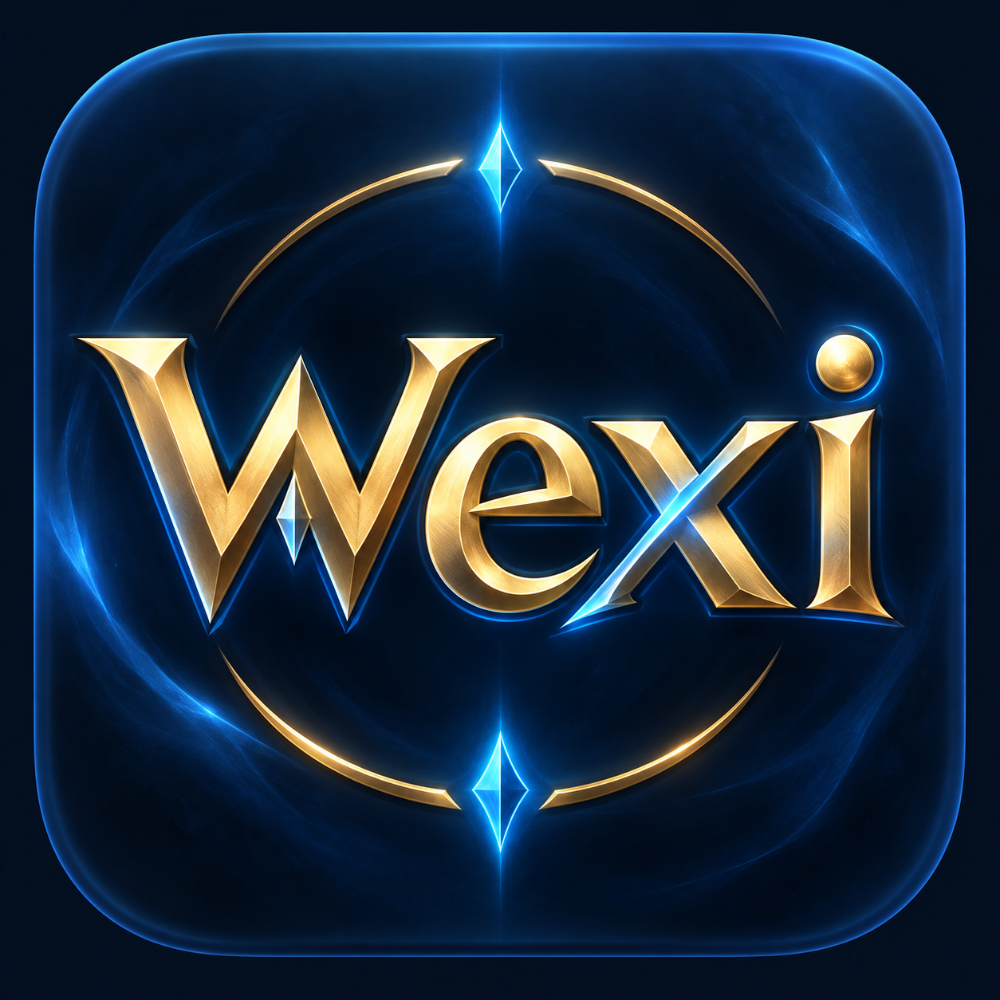
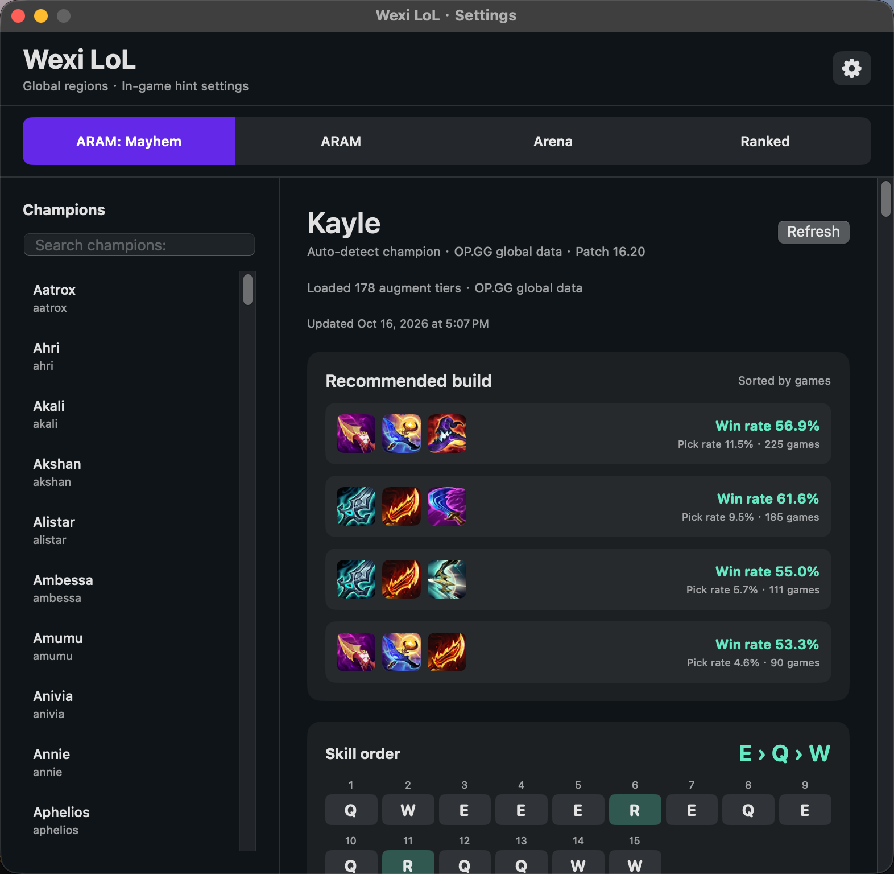

<p align="center">
  
</p>
<h1 align="center">Wexi LoL</h1>
<p align="center"><strong>League of Legends companion overlay for macOS</strong></p>
<p align="center">英雄联盟 macOS 游戏内辅助悬浮工具</p>

<p align="center">
  <a href="https://loeraw.github.io/Wexi-LoL/"></a>
  <a href="https://www.apple.com/macos/"></a>
  <a href="https://www.swift.org/"></a>
  <a href="https://github.com/Loeraw/Wexi-LoL/releases/tag/v0.5.4"></a>
  <a href="LICENSE"></a>
</p>

Wexi LoL 是一款原生 macOS 英雄联盟游戏内辅助悬浮工具，提供海克斯评级、技能加点提示、目标计时、出装推荐和对局玩家资料。

Wexi LoL is a native macOS companion overlay for League of Legends. It provides augment ratings, skill-up suggestions, objective timers, item-build recommendations, and player scouting.

<p align="center"><a href="https://loeraw.github.io/Wexi-LoL/"><strong>官方网站 / Official website</strong></a></p>

<p align="center">
  
</p>
<p align="center"><em>四模式攻略、推荐出装与胜率 / Four-mode guides, recommended builds, and win rates</em></p>

## 下载 / Download

<p align="center">
  <a href="https://github.com/Loeraw/Wexi-LoL/releases/download/v0.5.4/Wexi.LoL-0.5.4.dmg">
    
  </a>
</p>

当前安装包使用本地 ad-hoc 签名，尚未经过 Apple 公证。macOS 首次打开时可能显示安全提示，可前往“系统设置 → 隐私与安全性”选择“仍要打开”。

The current build uses a local ad-hoc signature and has not been notarized by Apple. On first launch, macOS may block the app. Open **System Settings → Privacy & Security** and choose **Open Anyway**.

## 功能 / Features

| 功能 | 中文 | English |
| --- | --- | --- |
| 海克斯评级 | 识别三选一海克斯卡片，并在对应位置显示 S / T1–T5 评级 | Recognizes the three augment choices and displays S / T1–T5 ratings in place |
| 技能加点 | 根据当前英雄、等级和已分配技能点提示下一次 Q/W/E/R 加点 | Suggests the next Q/W/E/R upgrade from the champion, level, and current ranks |
| 目标计时 | 显示峡谷史诗目标刷新时间，并在大乱斗小地图上显示血包倒计时 | Tracks Rift epic objectives and shows ARAM health-relic countdowns on the minimap |
| 出装推荐 | 显示 OP.GG 主流三件套、胜率、选用率和下一件装备 | Shows popular OP.GG three-item builds, win rate, pick rate, and the next item |
| 模式面板 | 主界面按排位、大乱斗混乱、极地大乱斗和斗魂竞技场分别展示攻略；斗魂海克斯根据胜率与样本生成评级 | Separate guide panels for Ranked, ARAM: Mayhem, ARAM, and Arena; Arena augment tiers are calculated from win rate and sample size |
| 玩家资料 | 自动识别当前区服，在 Loading 时读取本局 10 名玩家的段位、胜率和最近 5 场 W/L，游戏内按住 Tab 显示缓存 | Auto-detects the current region, loads rank, win rate, and recent W/L for all 10 players during loading, then shows cached data while Tab is held |
| 多语言界面与识别 | Wexi 界面可选择 12 种语言；游戏客户端语言可独立选择 15 种，并加载对应 OP.GG 海克斯名称与 Vision OCR | Choose from 12 Wexi interface languages and independently select one of 15 game-client languages for localized OP.GG augment names and Vision OCR |

正常提示窗口支持鼠标穿透，不会阻止点击技能或海克斯卡片。游戏进入后台时，提示会自动隐藏。

Normal overlay hints ignore mouse input, so they do not block skills or augment cards. Hints hide automatically when the game is no longer in the foreground.

## 系统要求 / Requirements

- macOS 13 Ventura 或更新版本 / macOS 13 Ventura or later
- 画面识别功能需要 macOS 14 或更新版本 / Screen recognition requires macOS 14 or later
- League of Legends macOS 客户端 / League of Legends for macOS
- 海克斯、出装和玩家资料需要网络连接 / Internet access for augment, build, and player data
- Xcode / Swift 5.9 仅在从源码构建时需要 / Xcode and Swift 5.9 are required only when building from source

## 安装与权限 / Installation and Permissions

1. 下载并打开 DMG，将 **Wexi LoL.app** 拖入 Applications。
2. 首次运行时，根据 macOS 提示允许 Wexi LoL 使用屏幕录制权限。
3. 如果系统阻止启动，请在“系统设置 → 隐私与安全性”中选择“仍要打开”。
4. 设置窗口可以最小化到程序坞，也可以从菜单栏的 Wexi LoL 图标重新打开。

1. Download and open the DMG, then drag **Wexi LoL.app** into Applications.
2. On first launch, allow Screen Recording when macOS asks for permission.
3. If macOS blocks the app, open **System Settings → Privacy & Security** and select **Open Anyway**.
4. The settings window can be minimized to the Dock or reopened from the Wexi LoL menu-bar icon.

屏幕录制只用于读取前台英雄联盟游戏窗口中的技能栏、海克斯选择和 Tab 计分板。应用不会保存或上传截图。

Screen Recording is used only to read the foreground League of Legends window for the skill bar, augment choices, and Tab scoreboard. The app does not save or upload screenshots.

## 使用 / Usage

### 海克斯与技能 / Augments and Skills

- 海克斯三选一出现时，评级标签会显示在对应卡片附近。刷新单张卡片时，未刷新的识别结果会保留。
- 有可用技能点时，应用会在推荐的 Q/W/E/R 升级位置显示提示。
- 如果技能位置无法自动识别，可在设置中选择“校准技能＋位置”，拖动四个标记后按 Option-Command-K 保存。
- “Wexi 语言”控制应用界面和攻略显示；“游戏客户端语言”应选择与英雄联盟客户端一致的语言，以加载对应海克斯名称供 OCR 匹配。
- 游戏客户端识别支持简体中文、繁体中文、英语、韩语、日语、法语、德语、西班牙语、葡萄牙语、俄语、土耳其语、波兰语、意大利语、泰语和越南语。

- When three augment choices appear, rating labels are placed near their matching cards. Rerolling one slot preserves the unchanged results.
- When a skill point is available, the app shows a recommendation over the corresponding Q/W/E/R upgrade position.
- If automatic skill placement fails, choose **Calibrate skill + positions**, move all four markers, and press Option-Command-K to save.
- **Wexi language** controls the app interface and guide display. Set **Game client language** to the language used by League so Wexi can load matching augment names for OCR.
- Game-client recognition supports Simplified Chinese, Traditional Chinese, English, Korean, Japanese, French, German, Spanish, Portuguese, Russian, Turkish, Polish, Italian, Thai, and Vietnamese.

### 目标计时 / Objective Timers

- 召唤师峡谷使用 Riot 本地事件计算小龙、远古巨龙、先锋和纳什男爵时间。
- 大乱斗中按住 Tab 约一秒可读取游戏计分板上的血包时间；松开后，倒计时继续显示在小地图中的血包位置。

- On Summoner's Rift, Riot local events are used to calculate dragon, Elder Dragon, Rift Herald, and Baron timers.
- In ARAM, hold Tab for about one second to read the scoreboard's health-relic timers. After Tab is released, countdowns continue at their minimap locations.

### 对局玩家 / Player Scouting

- Loading 界面只读取一次当前 10 名玩家的公开 OP.GG 资料，并缓存在本局内存中。
- 应用会自动读取英雄联盟客户端的区服；如果未能识别，可在设置中手动选择 NA、ME、EUW、EUNE、OCE、KR、JP、BR、LAS、LAN、RU、TR、SEA、TW 或 VN。
- 进入游戏后资料自动隐藏；只有按住物理 Tab 键时才显示缓存，不会重复请求 OP.GG。
- 绿色 W 表示胜利，红色 L 表示失败。

- The loading screen fetches public OP.GG profiles for the 10 current players once and keeps them in an in-memory match cache.
- The app detects the League client region automatically. If detection is unavailable, Settings lets you choose NA, ME, EUW, EUNE, OCE, KR, JP, BR, LAS, LAN, RU, TR, SEA, TW, or VN manually.
- Profiles hide after the game starts and reappear from cache only while the physical Tab key is held. OP.GG is not requested again.
- Green **W** means win; red **L** means loss.

## 数据来源与隐私 / Data Sources and Privacy

- 英雄、等级、技能、装备和目标事件来自 Riot 本机游戏接口。
- 海克斯评级、技能顺序、出装和公开玩家资料来自 [OP.GG](https://op.gg/) 公共页面。
- 玩家资料会根据自动识别或手动选择的区服访问对应的 OP.GG 页面。
- 应用不读取游戏进程内存、不注入游戏、不自动点击、不自动选卡或加点。
- 玩家资料仅保存在本局内存缓存中，不写入磁盘。
- 本机诊断状态保存在 `~/Library/Application Support/WexiLoL/status.json`，不包含截图、完整 OCR 文本或玩家身份。

- Champion, level, skill, item, and objective-event data comes from Riot's local game APIs.
- Augment ratings, skill orders, builds, and public player profiles come from public [OP.GG](https://op.gg/) pages.
- Player scouting uses the OP.GG page for the automatically detected or manually selected region.
- The app does not read game-process memory, inject into the game, click automatically, choose augments, or spend skill points.
- Player profiles remain only in the current match's in-memory cache and are not written to disk.
- Local diagnostics are stored at `~/Library/Application Support/WexiLoL/status.json` and do not include screenshots, full OCR text, or player identities.

## 从源码构建 / Build from Source

项目使用 Swift Package Manager，没有第三方包依赖。

The project uses Swift Package Manager and has no third-party package dependencies.

```sh
git clone https://github.com/Loeraw/Wexi-LoL.git
cd Wexi-LoL
./script/build_and_run.sh --verify
```

运行测试 / Run tests:

```sh
swift test
```

生成 DMG 和源码包 / Build the DMG and source archive:

```sh
./script/package_dmg.sh
./script/package_source.sh
```

当前测试套件包含 53 项测试，其中三项公共网页冒烟测试需要单独提供本地 fixture。

The current suite contains 53 tests. Three public-page smoke tests require optional local fixtures.

## 已知限制 / Known Limitations

- OP.GG 页面结构改变或网络异常时，对应功能可能暂时不可用。
- OCR 可靠性会受到游戏分辨率、HUD 缩放、语言和界面变化影响。
- 评级是英雄的静态统计评级，不会根据本局装备或已选海克斯重新计算。
- 当前 DMG 未使用 Apple Developer ID 签名或公证。

- OP.GG page changes or network failures may temporarily disable related features.
- OCR reliability depends on game resolution, HUD scale, language, and UI changes.
- Ratings are static champion statistics and are not recalculated from the current build or selected augments.
- The current DMG is not signed with an Apple Developer ID or notarized.

## 致谢与数据归属 / Credits and Data Attribution

Wexi LoL 的海克斯评级、技能顺序、推荐出装、胜率以及公开玩家资料以 [OP.GG](https://op.gg/) 公共页面提供的数据为来源。感谢 OP.GG 为英雄联盟玩家社区提供统计数据与对局信息。

OP.GG 名称、品牌及相关内容归其各自权利人所有。Wexi LoL 是独立的开源项目，与 OP.GG 不存在隶属、合作、赞助、授权或认可关系。

Wexi LoL uses data available from public [OP.GG](https://op.gg/) pages for augment ratings, skill orders, recommended builds, win rates, and public player profiles. We thank OP.GG for providing statistics and match information to the League of Legends community.

The OP.GG name, brand, and related content belong to their respective owners. Wexi LoL is an independent open-source project and is not affiliated with, partnered with, sponsored by, authorized by, or endorsed by OP.GG.

## 许可证 / License

本项目采用 [MIT License](LICENSE)。

This project is available under the [MIT License](LICENSE).

## 声明 / Disclaimer

Wexi LoL 与 Riot Games 没有隶属、授权或认可关系。League of Legends、Riot Games 及其相关资产属于各自权利人。

Wexi LoL is not endorsed by Riot Games and does not reflect the views or opinions of Riot Games or anyone officially involved in producing or managing Riot Games properties. Riot Games and all associated properties are trademarks or registered trademarks of Riot Games, Inc.
